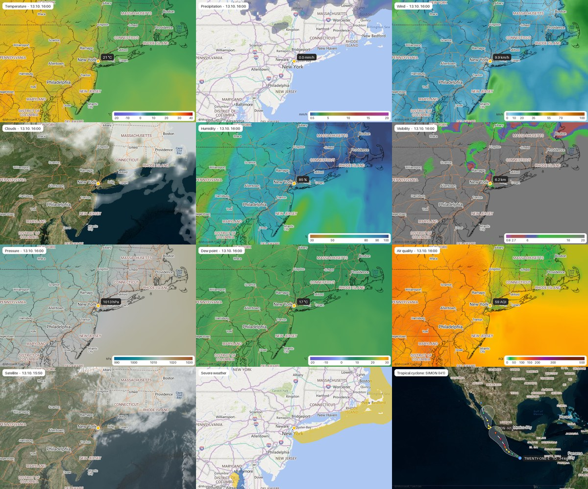
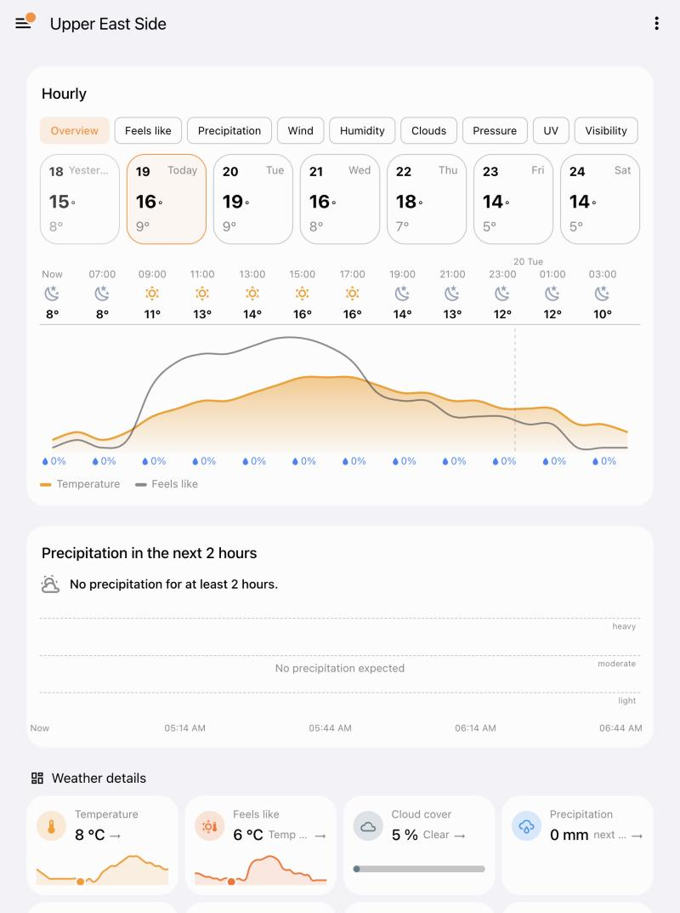
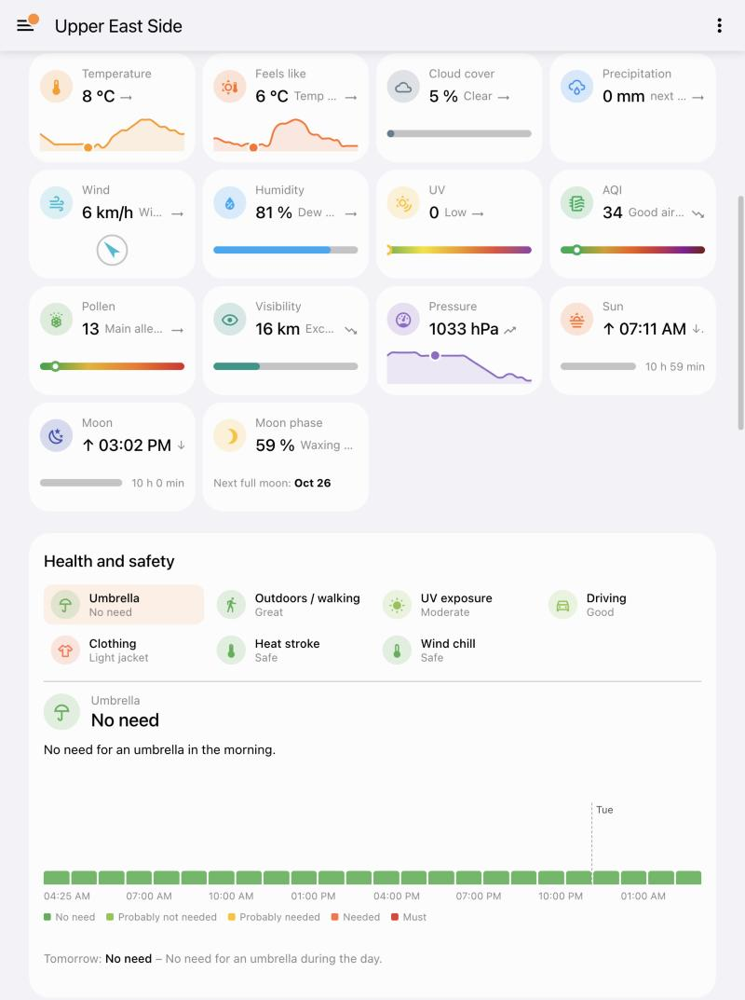

# MSN Weather

[](https://github.com/42bios/ha-msn-weather/actions/workflows/ci.yml)
[](https://github.com/42bios/ha-msn-weather/actions/workflows/hacs-validate.yml)
[](https://github.com/42bios/ha-msn-weather/actions/workflows/hassfest.yml)
[](https://my.home-assistant.io/redirect/hacs_repository/?owner=42bios&repository=ha-msn-weather&category=integration)
[](https://github.com/42bios/ha-msn-weather/releases)

Home Assistant custom integration for MSN Weather (msn.com/weather): everything the website shows, as entities, maps and dashboard cards.


> **Disclaimer:** This is an unofficial, community-maintained integration and is not affiliated with, endorsed by, or supported by Microsoft or MSN. All product names, logos, and brands are property of their respective owners and are used for identification purposes only.

## Highlights
- **Weather entity** with hourly, daily and day/night forecasts for 10 days.
- **Sensors** for all weather details, life indices (umbrella, driving, clothing, ...), air quality, pollen, climate normals and a monthly forecast.
- **Minute-by-minute precipitation** for the next 2 hours, **weather alerts** and **tropical cyclones**.
- **Animated weather maps** as image entities: radar, temperature, precipitation, wind, clouds, satellite, lightning and more.
- **Dashboard cards** in MSN or Home Assistant style, loaded automatically, plus a complete weather view in one step.
- **Blueprints** for alert, umbrella and cyclone notifications.



## Installation

Requires Home Assistant 2025.1 or newer.

[](https://my.home-assistant.io/redirect/hacs_repository/?owner=42bios&repository=ha-msn-weather&category=integration)

The button opens the Marketplace on Home Assistant 2026.11 or newer, and HACS on older versions.

### Marketplace (Home Assistant 2026.11 or newer)
1. Open `Settings -> Marketplace` and search for `MSN Weather`.
2. Install it.

### HACS (older Home Assistant versions)
1. Open HACS and search for `MSN Weather`.
2. Download it and restart Home Assistant.

### Manual
1. Copy `custom_components/msn_weather` into the `custom_components` folder of your Home Assistant configuration.
2. Restart Home Assistant.

## Setup

[](https://my.home-assistant.io/redirect/config_flow_start/?domain=msn_weather)

1. Add the integration under `Settings -> Devices & Services -> Add Integration`.
2. Keep the location of your Home Assistant installation, pick another place on the map, or paste an MSN weather URL.
3. Optional: adjust language, update interval, maps and the tropical cyclone radius in the integration options.

Units and language follow your Home Assistant settings.

### API key
MSN's web API is unofficial and may change at any time. The integration reads the current API key from msn.com automatically. If that fails, a repair issue appears and you can enter a key in the integration options: you find it in your browser's developer tools on msn.com/weather (network tab, request `weather/overview`, parameter `apikey`).

## Dashboard

<p align="center"> </p>

The cards appear in the card picker as "MSN Weather - ..." and have a visual editor. For a complete weather view, create a dashboard with this configuration:

```yaml
strategy:
  type: custom:msn-weather
```

## Documentation
- [Configuration](https://github.com/42bios/ha-msn-weather/blob/main/docs/configuration.md): location, options, units, languages, API key and diagnostics
- [Cards](https://github.com/42bios/ha-msn-weather/blob/main/docs/cards.md): all cards, their options and the weather view
- [Entities](https://github.com/42bios/ha-msn-weather/blob/main/docs/entities.md): weather entity, sensors and their attributes
- [Weather maps](https://github.com/42bios/ha-msn-weather/blob/main/docs/maps.md): map layers, forecast, zoom and tropical cyclones
- [Blueprints](https://github.com/42bios/ha-msn-weather/blob/main/docs/blueprints.md): severe weather alert, umbrella reminder, tropical cyclone nearby

## Support

- Issues: https://github.com/42bios/ha-msn-weather/issues (please attach the diagnostics download of the integration)

<a href="https://www.buymeacoffee.com/42bios">
  
</a>

## License
MIT - see [LICENSE](LICENSE).
