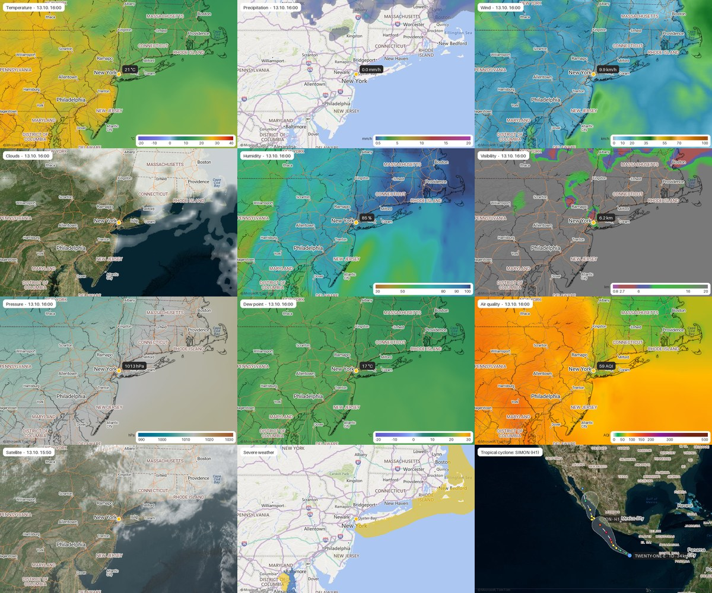
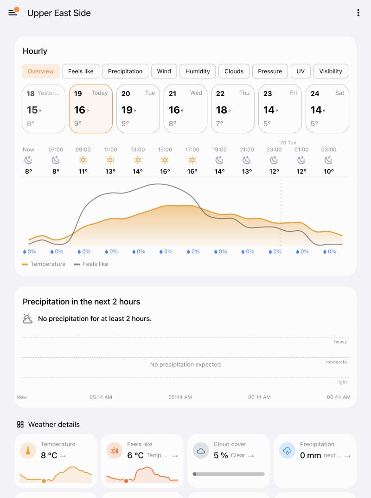
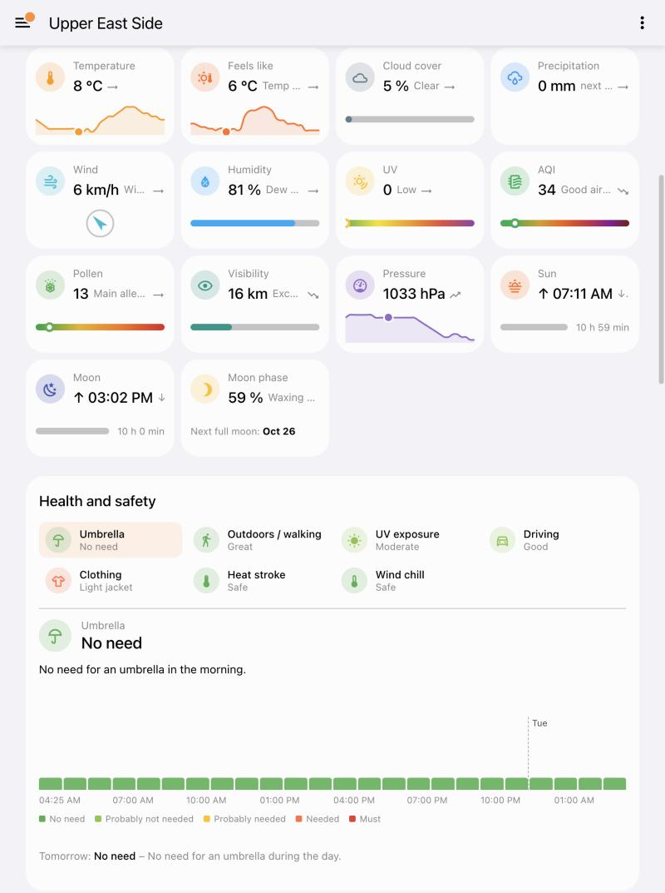
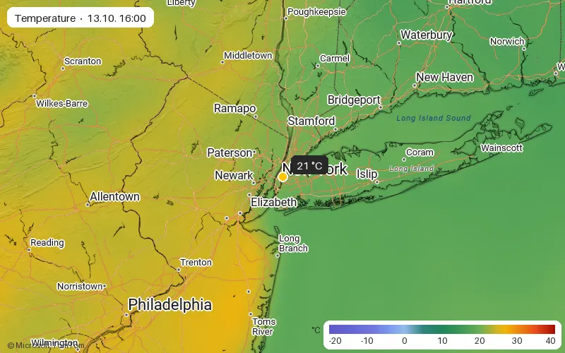

# MSN Weather for Home Assistant

[](https://github.com/42bios/ha-msn-weather/actions/workflows/validate.yml)
[](https://hacs.xyz/docs/faq/custom_repositories)
[](https://github.com/42bios/ha-msn-weather/releases)

Home Assistant custom integration that brings **MSN Weather** (msn.com/weather) to Home Assistant – everything the
website shows, as entities, maps and dashboard cards.


[](https://my.home-assistant.io/redirect/hacs_repository/?owner=42bios&repository=ha-msn-weather&category=integration)

> **Disclaimer:** This is an unofficial, community-maintained integration and is not affiliated with, endorsed by, or
> supported by Microsoft or MSN. All product names, logos and brands are property of their respective owners and are
> used for identification purposes only.

## Highlights

- **Weather entity** with hourly, daily and day/night forecasts (10 days)
- **Sensors** for all "weather details" tiles, including MSN's texts ("Falling", "Pleasant", …)
- **Life indices**: health and safety (umbrella, driving, clothing, …) and activities, each with an hourly outlook
- **Daily values from yesterday to +9 days**, yesterday sensors, **climate normals and records since 1951** and a
  **~30 day monthly forecast**
- **Minute-by-minute precipitation**: when rain starts and stops in the next 2 hours, and the **precipitation radar**
- **Weather alerts** with period and safety advice, **tropical cyclones** with a configurable radius
- **Animated weather maps** as image entities (radar, temperature, precipitation, wind, clouds, satellite, severe
  weather, lightning, winter weather, tropical cyclones, …)
- **Lovelace cards** in MSN style or classic Home Assistant style, shipped with the integration and freely
  arrangeable – or a complete weather view in one step
- **Blueprints** for alert, umbrella and cyclone notifications; values in metric or US units following Home Assistant



The data comes from the same endpoints the MSN website uses (weather model Foreca, pollen polleninfo.org,
tropical cyclones NHC/JMA/CMA). Everything follows your Home Assistant language: the MSN texts use the language
chosen in the options (defaults to your Home Assistant language), the cards use the language of the logged-in user.

**Units follow your Home Assistant unit system:** with *US customary* MSN is queried in °F, mph, inHg, miles and
inches – values, MSN texts ("Steady at 60°", "gusts to 18 mph"), map legends and cards all use those units; with
*metric* everything is °C, km/h, hPa, km and mm. The tropical cyclone radius is entered in miles or kilometers
accordingly.

> ⚠️ This is an unofficial API and Microsoft may change it at any time. When MSN rotates its public web API key,
> the integration reads the current key from msn.com automatically. If that fails, a repair issue appears
> (*Settings → Repairs*) and you can enter a key in the integration options – you find it in your browser's
> developer tools on msn.com/weather (network tab → request `weather/overview` → parameter `apikey`).

## Installation

**HACS:** *HACS → Custom repositories* → URL of this repository, type *Integration* → install "MSN Weather" →
restart Home Assistant.

**Manual:** copy `custom_components/msn_weather` to `<config>/custom_components/` and restart Home Assistant.

Then: *Settings → Devices & services → Add integration → MSN Weather*.

- By default the **location of your Home Assistant installation** is used – and followed if you change it later.
- Optionally switch that off and pick another place on the map, or paste an MSN weather URL (it takes precedence),
  e.g. `https://www.msn.com/en-us/weather/forecast/in-New-York,NY?loc=eyJsIjoi...`
- Language of the MSN texts (defaults to your Home Assistant language)
- Options: language of the MSN texts, update interval (default 15 min), map zoom, image size, animation frames and speed,
  high resolution,
  title and legend in the images (off = the map card shows them as overlays),
  tropical cyclone radius / focus / disturbances, API key

## Weather view in one step

The integration ships a dashboard strategy that builds a complete weather view from all cards (hourly, weather
details, health and safety, activities, monthly forecast and all enabled maps):

```yaml
# a whole dashboard (one view per MSN Weather entry): Settings → Dashboards → Add dashboard →
# "New dashboard from scratch" → ⋮ → Raw configuration editor
strategy:
  type: custom:msn-weather
  appearance: ha          # optional: ha (default) | msn
  maps: true              # optional
  life: tiles             # optional: tiles (default, one tile per index) | cards

# or a single view inside an existing dashboard
views:
  - strategy:
      type: custom:msn-weather
      entity: weather.upper_east_side   # optional, default: first MSN Weather entry
```

Take control (⋮ → *Take control*) to turn the generated view into normal cards you can edit.

## Lovelace cards

<p align="center"> </p>

The integration ships eleven cards and loads them automatically – no resource needs to be added. All cards have a
visual editor and appear in the card picker as "MSN Weather – …".

| Card | Content |
|---|---|
| `custom:msn-weather-tile-card` | **one** weather detail tile, freely placeable in a sections dashboard |
| `custom:msn-weather-hourly-card` | day cards (yesterday … +9, clickable) and an hourly chart with tabs |
| `custom:msn-weather-rain-card` | when rain (or snow) starts, until when it lasts, how much falls and how likely – minute-exact for the next 2 hours, then from the hourly forecast (48 h); official warnings stay in the alerts card |
| `custom:msn-weather-rain-chart-card` | precipitation per hour as bars with the time below and the amounts above (default 48 h, `hours`) |
| `custom:msn-weather-alerts-card` | active and upcoming weather warnings (NWS and Meteoalarm) with event icon, level badge, period, "starts in …" / "active until …" and safety advice (optionally hidden when there is none) |
| `custom:msn-weather-nowcast-card` | precipitation of the next 2 hours in 4 minute steps – when rain starts and stops |
| `custom:msn-weather-life-tile-card` | **one** life index (umbrella, cycling, driving, …) as its own tile with hourly outlook, same size as the weather tiles |
| `custom:msn-weather-life-card` | health and safety / activities with an hourly bar chart |
| `custom:msn-weather-monthly-card` | calendar with the monthly forecast, climate normals and records |
| `custom:msn-weather-map-card` | weather map with the correct aspect ratio (also in the editor preview); plays the animation itself so the time in the title always matches the shown frame |
| `custom:msn-weather-details-card` | all tiles in one card (shortcut) |

Every card offers two appearances, selectable in the editor (`appearance`):

- `msn` (default) – looks like msn.com
- `ha` – classic Home Assistant look: tile-card style tiles (colored icon, name, value, compact mini graph),
  theme colors and outlines instead of filled panels – same data and functions

All cards adapt to the size set in the sections dashboard (width and height) without scrollbars. Tiles all have the
same size (default 6 × 3 grid cells) and scale their graphics. Every card accepts an optional `language` (en, de, it, fr, es, nl)
to override the Home Assistant language.

```yaml
# single tile – tile: temperature | feels | clouds | precipitation | nowcast | wind | humidity | uv |
#                     aqi | pollen | visibility | pressure | sun | moon | moonphase
type: custom:msn-weather-tile-card
entity: weather.upper_east_side
tile: wind
appearance: ha            # optional: msn (default) | ha

type: custom:msn-weather-hourly-card
entity: weather.upper_east_side
hours: 24                 # optional
show_days: true           # optional, day cards on top
tabs: [overview, feels, precipitation, wind, humidity, cloudcover, pressure, uv, visibility, aqi]
show_chart: true          # optional, false = only the day cards
# single parts: tabs: [wind] + show_days: false = only the wind chart (no tab bar, title "Wind");
#               show_chart: false = only the day cards

type: custom:msn-weather-life-card
entity: weather.upper_east_side
mode: health              # health | activities

type: custom:msn-weather-monthly-card
entity: weather.upper_east_side

type: custom:msn-weather-map-card
entity: image.upper_east_side_map_precipitation
zoom: 6                   # optional: fixed zoom of this map (3 = continent … 11 = local)
show_legend: true         # optional: legend overlay (tap to collapse) when the image has no legend
show_zoom: false          # optional: + / − buttons for the shared zoom of all maps
fit: cover                # cover | contain
```

Clicking a tile opens the more-info dialog of the matching sensor.

## Entities

Entity IDs are language independent: `<domain>.<entry name>_<key>`, e.g. `sensor.upper_east_side_umbrella`,
`image.upper_east_side_map_precipitation` or `number.upper_east_side_map_forecast_hours` – only the displayed names are
translated. The examples use an entry named "Upper East Side".

### Weather entity `weather.<name>`
Forecasts via `weather.get_forecasts`:

| Type | Range | Fields |
|---|---|---|
| `hourly` | ~220 hours | condition, temperature, feels like, dew point, humidity, pressure, precipitation, probability, wind, gusts, bearing, cloud cover, UV, `visibility`, `aqi` |
| `daily` | 10 days | high/low, feels like, precipitation, probability, wind and gusts, UV, humidity, cloud cover, pressure/visibility ranges, rain day/night, pollen, sunrise/sunset, moonrise/moonset, `summary` |
| `twice_daily` | 10 days, day and night | condition, temperature, probability, wind, `summary` |

### Sensors (weather details)
Every sensor carries the texts of the MSN tile as attributes: `headline`, `summary`, `details`, `trend`; tile
sensors additionally carry `today_series` (the hourly curve of today).

| Tile | Sensors |
|---|---|
| Temperature / feels like | temperature, today's high/low, feels like, dew point |
| Cloud cover | condition (text), cloud cover % |
| Precipitation | precipitation today, probability, precipitation next 2 h (nowcast: MSN text, 4 minute values, `template_type`, `minutes_to_change`), "precipitation change in" (minutes until rain starts/stops) |
| Wind | speed, gusts, bearing (degrees and text) |
| Humidity, UV, visibility, pressure | one sensor each |
| AQI | index, O₃, PM2.5, PM10, NO₂, CO, SO₂; attribute `forecast` with hourly pollutant values |
| Pollen | index with level, main allergen, per pollen type, forecast |
| Sun / moon | rise/set, day length, moon visible, moon phase, illumination, next full moon |
| Alerts | number of weather alerts (list as attribute, with `source` = the national weather service, e.g. NWS, Météo-France, MeteoSwiss, JMA) and binary sensor "alert active"; `significance` is R / O / Y / B (red / orange / yellow / blue) for every country |
| Tropical cyclones | number of active storms within the configured radius (worldwide when 0); attributes `nearest`, `strongest`, `storms` (name, category, wind, position, distance, closest forecast approach), `worldwide`; binary sensor "tropical cyclone nearby" |
| Yesterday | high/low, precipitation; optional feels like, wind/gusts, humidity, pressure, UV, visibility, cloud cover |
| Daily details | attribute `days`: per day (yesterday … +9) highs/lows of all values, rain day/night, pollen, sun/moon, MSN texts |
| Climate | normal high/low for today, record high/low (with year), normal precipitation (with records, snow, wind) – data since 1951 |
| Monthly forecast | attribute `days`: ~40 days with condition, high/low, rain probability, wind |

### Sensors (life indices)
State = MSN short text ("Light jacket", "Not needed", "Great"). Attributes: `summary`, `category` (1 = good …
5 = poor), `value`, the values for tomorrow and `hourly` (hourly outlook for today and tomorrow).

- **Health and safety:** umbrella, outdoors/walking, UV exposure, driving, clothing, heat stroke, wind chill
- **Activities** (disabled by default): cycling, gardening, hiking, running, stargazing, picnic

### Weather maps (image entities)

Like on msn.com the maps are **animated** (animated WebP): forecast layers step through the next hours, the
satellite image through the last 2 hours. The number of frames is configurable (1 = no animation). With
**high resolution** (default on) maps are rendered at twice the pixel density and stay sharp when shown large.



| Map | Content | Forecast |
|---|---|---|
| Temperature ✅, wind ✅, humidity, visibility, pressure, dew point | heat maps | up to +10 days |
| Precipitation radar ✅ | minute-by-minute radar like msn.com: rain, snow and sleet in six intensities, animated from about 1 h ago to 2 h ahead (4 minute data) | ~+3 h |
| Precipitation ✅ | precipitation rate mm/h on a road map | up to +10 days |
| Clouds ✅ | clouds over aerial imagery | ~+12 h |
| Satellite ✅ | satellite image, last 2 h | – |
| Severe weather ✅ | warning areas yellow/orange/red | – |
| Lightning ✅ | strikes of the last 2 h, colored by age | – |
| Tropical cyclone ✅ | animated: the storm moves along its observed and forecast track, with forecast cone and category | up to ~5 days |
| Winter weather | snowfall + winter storm warning areas | up to +10 days |
| Air quality | AQI heat map (Europe) | ~+4 days |
| Pollen | pollen heat map (Europe) | – |

✅ = enabled by default. The **map forecast** number (0–240 h) moves all forecast-capable maps to "now + x hours";
the **map zoom** number (3 = continent … 11 = local) zooms all maps live. A single map gets its own zoom with the
`zoom` setting of the map card (service `msn_weather.set_map_zoom`).
Attributes: `valid_time`, `value_at_location`, `frames`, `width`, `height`.

**Tropical cyclones** – in the integration options you choose:

- **Radius** (km, 0 = worldwide): only storms that are inside this radius, or are forecast to move into it, are
  counted and shown.
- **Focus**: the map follows the *strongest* (default) or the *nearest* storm.
- **Disturbances**: whether disturbances are drawn on the map.

The select entity `select.<name>_cyclone_map_storm` switches the map to a specific storm (`auto` = focus option).
The map card shows one button per active storm for this.

How it works: MSN delivers most layers as *data tiles* (values encoded in pixels) and colors them in the browser.
The integration decodes the tiles, interpolates them, applies MSN's color scales and composes them with Bing map
tiles (terrain shading, borders, labels). The radar is a vector format: MSN publishes precipitation polygons
per tile every 4 minutes (observations and a ~3 hour nowcast), which the integration draws with MSN's colors.

Map images use stable access tokens (derived from a per-entry secret), so dashboards and the companion app that
stay open during a Home Assistant restart keep loading the maps instead of producing failed logins.

## Blueprints

Ready-made automations in [`blueprints/automation/msn_weather`](blueprints/automation/msn_weather) – import them
via *Settings → Automations & scenes → Blueprints → Import blueprint* with the file's GitHub URL, or copy them to
`<config>/blueprints/automation/msn_weather/`:

| Blueprint | Triggers | Variables for the message |
|---|---|---|
| Severe weather alert | a weather warning becomes active | `title`, `level`, `description` |
| Umbrella reminder | at a set time, if the umbrella index reaches a category (language independent) | `state`, `summary` |
| Tropical cyclone nearby | a storm enters (or is forecast to enter) the configured radius | `storms`, `closest_km` |

The actions are up to you, e.g. a notification to the companion app.

## Languages and diagnostics

Entity names, setup and options are translated into English, German, Italian, French, Spanish and Dutch; the MSN
texts and map labels use the language chosen in the options. The cards use the language of the logged-in user
(English, German, Italian, French, Spanish, Dutch; others show English) and accept `language: en | de | it | fr | es | nl`.

*Settings → Devices & services → MSN Weather → ⋮ → Download diagnostics* produces a report without location,
name or keys – attach it to bug reports.

## Development

```bash
pip install -r requirements_test.txt
pytest                        # unit tests with recorded MSN responses (tests/fixtures, New York)
python scripts/live_check.py  # checks the real MSN endpoints – also runs weekly in CI
```

## Support

- Issues: https://github.com/42bios/ha-msn-weather/issues

<a href="https://www.buymeacoffee.com/42bios">
  
</a>

## License

MIT
