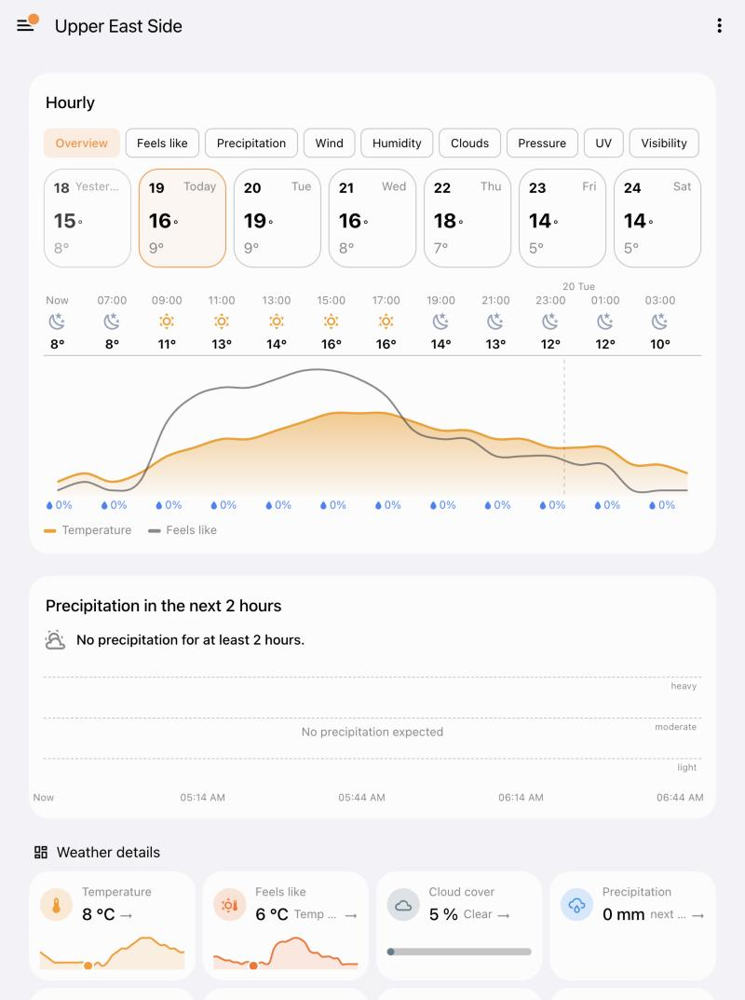
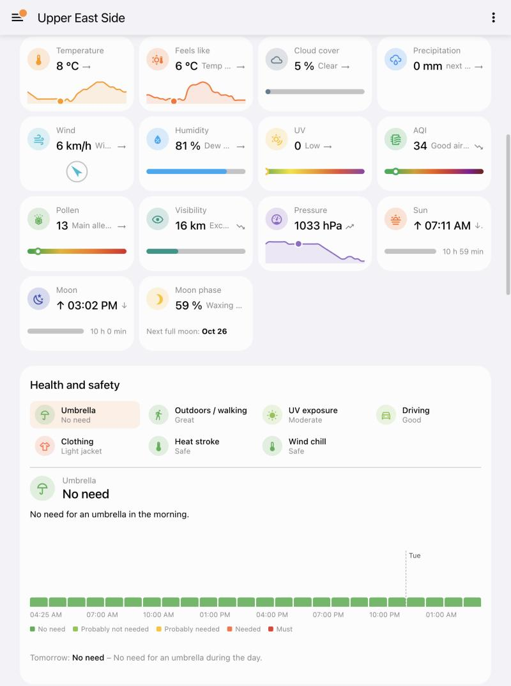

# Lovelace cards

<p align="center"> </p>

The integration ships eleven cards and loads them automatically – no resource needs to be added. All cards have a
visual editor and appear in the card picker as "MSN Weather – …".

| Card | Content |
|---|---|
| `custom:msn-weather-tile-card` | **one** weather detail tile, freely placeable in a sections dashboard |
| `custom:msn-weather-hourly-card` | day cards (yesterday … +9, clickable) and an hourly chart with tabs |
| `custom:msn-weather-rain-card` | when rain (or snow) starts, until when it lasts, how much falls and how likely – minute-exact for the next 2 hours, then from the hourly forecast (48 h); official warnings stay in the alerts card |
| `custom:msn-weather-rain-chart-card` | precipitation per hour as bars with the time below and the amounts above (default 48 h, `hours`) |
| `custom:msn-weather-alerts-card` | active and upcoming weather warnings (NWS and Meteoalarm) with event icon, level badge, period, "starts in …" / "active until …" and safety advice (optionally hidden when there is none) |
| `custom:msn-weather-nowcast-card` | precipitation of the next 2 hours in 4 minute steps – when rain starts and stops |
| `custom:msn-weather-life-tile-card` | **one** life index (umbrella, cycling, driving, …) as its own tile with hourly outlook, same size as the weather tiles |
| `custom:msn-weather-life-card` | health and safety / activities with an hourly bar chart |
| `custom:msn-weather-monthly-card` | calendar with the monthly forecast, climate normals and records |
| `custom:msn-weather-map-card` | weather map with the correct aspect ratio (also in the editor preview); plays the animation itself so the time in the title always matches the shown frame |
| `custom:msn-weather-details-card` | all tiles in one card (shortcut) |

Every card offers two appearances, selectable in the editor (`appearance`):

- `msn` (default) – looks like msn.com
- `ha` – classic Home Assistant look: tile-card style tiles (colored icon, name, value, compact mini graph),
  theme colors and outlines instead of filled panels – same data and functions

All cards adapt to the size set in the sections dashboard (width and height) without scrollbars. Tiles all have the
same size (default 6 × 3 grid cells) and scale their graphics. Every card accepts an optional `language` (en, de, it, fr, es, nl)
to override the Home Assistant language.

```yaml
# single tile – tile: temperature | feels | clouds | precipitation | nowcast | wind | humidity | uv |
#                     aqi | pollen | visibility | pressure | sun | moon | moonphase
type: custom:msn-weather-tile-card
entity: weather.upper_east_side
tile: wind
appearance: ha            # optional: msn (default) | ha

type: custom:msn-weather-hourly-card
entity: weather.upper_east_side
hours: 24                 # optional
show_days: true           # optional, day cards on top
tabs: [overview, feels, precipitation, wind, humidity, cloudcover, pressure, uv, visibility, aqi]
show_chart: true          # optional, false = only the day cards
# single parts: tabs: [wind] + show_days: false = only the wind chart (no tab bar, title "Wind");
#               show_chart: false = only the day cards

type: custom:msn-weather-life-card
entity: weather.upper_east_side
mode: health              # health | activities

type: custom:msn-weather-monthly-card
entity: weather.upper_east_side

type: custom:msn-weather-map-card
entity: image.upper_east_side_map_precipitation
zoom: 6                   # optional: fixed zoom of this map (3 = continent … 11 = local)
show_legend: true         # optional: legend overlay (tap to collapse) when the image has no legend
show_zoom: false          # optional: + / − buttons for the shared zoom of all maps
fit: cover                # cover | contain
```

Clicking a tile opens the more-info dialog of the matching sensor.

[← Back to the README](../README.md)
