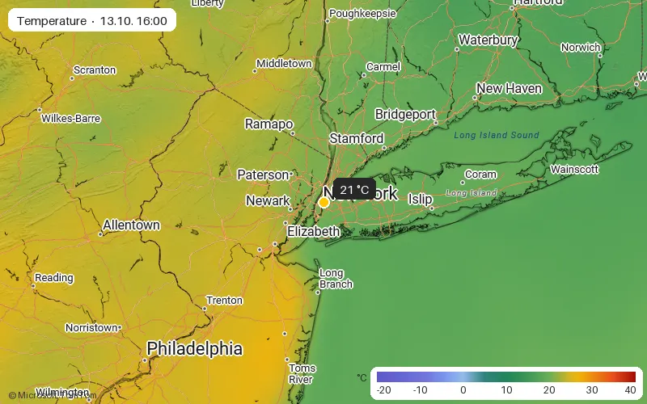

# Weather maps (image entities)

Like on msn.com the maps are **animated** (animated WebP): forecast layers step through the next hours, the
satellite image through the last 2 hours. The number of frames is configurable (1 = no animation). With
**high resolution** (default on) maps are rendered at twice the pixel density and stay sharp when shown large.

| Map | Content | Forecast |
|---|---|---|
| Temperature ✅, wind ✅, humidity, visibility, pressure, dew point | heat maps | up to +10 days |
| Precipitation radar ✅ | minute-by-minute radar like msn.com: rain, snow and sleet in six intensities, animated from about 1 h ago to 2 h ahead (4 minute data) | ~+3 h |
| Precipitation ✅ | precipitation rate mm/h on a road map | up to +10 days |
| Clouds ✅ | clouds over aerial imagery | ~+12 h |
| Satellite ✅ | satellite image, last 2 h | – |
| Severe weather ✅ | warning areas yellow/orange/red | – |
| Lightning ✅ | strikes of the last 2 h, colored by age | – |
| Tropical cyclone ✅ | animated: the storm moves along its observed and forecast track, with forecast cone and category | up to ~5 days |
| Winter weather | snowfall + winter storm warning areas | up to +10 days |
| Air quality | AQI heat map (Europe) | ~+4 days |
| Pollen | pollen heat map (Europe) | – |

✅ = enabled by default. The **map forecast** number (0–240 h) moves all forecast-capable maps to "now + x hours";
the **map zoom** number (3 = continent … 11 = local) zooms all maps live. A single map gets its own zoom with the
`zoom` setting of the map card (service `msn_weather.set_map_zoom`).
Attributes: `valid_time`, `value_at_location`, `frames`, `width`, `height`.

**Tropical cyclones** – in the integration options you choose:

- **Radius** (km, 0 = worldwide): only storms that are inside this radius, or are forecast to move into it, are
  counted and shown.
- **Focus**: the map follows the *strongest* (default) or the *nearest* storm.
- **Disturbances**: whether disturbances are drawn on the map.

The select entity `select.<name>_cyclone_map_storm` switches the map to a specific storm (`auto` = focus option).
The map card shows one button per active storm for this.

How it works: MSN delivers most layers as *data tiles* (values encoded in pixels) and colors them in the browser.
The integration decodes the tiles, interpolates them, applies MSN's color scales and composes them with Bing map
tiles (terrain shading, borders, labels). The radar is a vector format: MSN publishes precipitation polygons
per tile every 4 minutes (observations and a ~3 hour nowcast), which the integration draws with MSN's colors.

[← Back to the README](../README.md)
